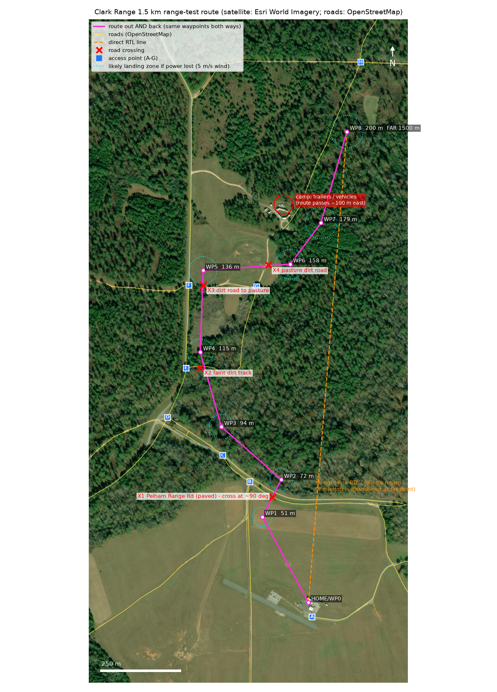
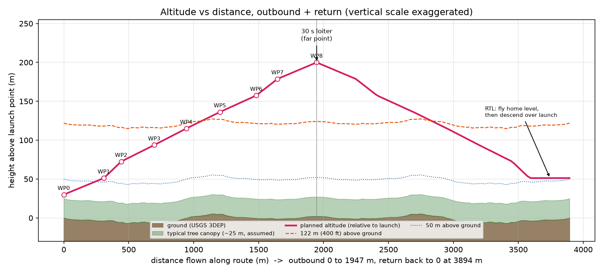

# 1.5 km mesh-radio range test: plan, mission and checklists (Route B, generally north)

Prepared 2026-10-02 for the 10-inch quad (LUX F765, ArduCopter 4.7.1). Files are in this folder (`range-test\route_B_north\`).

> **This is a planning aid, not an approval to fly.** Several items below need your decision or a real-world check before the mission goes on the aircraft. They are listed in section 0.

## 0. Decisions and checks only you can make

1. **Route.** You asked for a route that is generally north and follows roads, with dirt roads allowed. This plan (Route B) follows roads, including dirt roads, and ends 1500 m from launch at **bearing 4.7° (almost due north, 4.7° east of north)**. The earlier version, Route A, ends 12.6° west of north on a better road and is kept in `..\route_A_nnw_alternative\`. The tradeoffs are in section 2.
2. **Part of this route is only close to a road, not on one.** On the paved and gravel roads the route is 45 m beside the road. Over the pasture it is 45 to 85 m from the dirt road, and on the last 650 m it is 80 to 100 m east of a faint forest track, because of the camp (item 3). I placed the dirt-road and camp points by eye on the satellite image, because the mapped dirt road (a 2007 TIGER import) is misplaced. **Check the route on the ground and in Mission Planner's satellite view before flying.**
3. **A small camp with trailers and vehicles is about 100 m from the route.** It sits at the end of the dirt road, about 1.2 km out. I can't tell whether anyone is there. The route passes 90 m or more from the nearest building, which is outside the 76 m "power lost in a 10 m/s wind" landing radius. If someone lives or works there, tell them, or choose Route A, which stays 280 m away.
4. **Recovery gets worse at the far end.** The last two waypoints are over forest, and the nearest drivable road is about 225 m from the far point. See section 7.
5. **Land access.** This looks like former Fort McClellan / Pelham Range land (the map labels it, and OpenStreetMap shows roads named "Gate 3 Road" and "Gate 5 Road"). I can't confirm who owns it. Ask for permission to fly there and to walk off the roads, and **ask specifically about unexploded ordnance (UXO) before walking off a road to recover a drone.**
6. **Hover power is a guess.** I don't have your hover current, and your battery monitor has no current sensor. The battery numbers use 170, 220 and 280 W for hover. A 5-minute hover test with a clamp meter would replace the guess.
7. **Legal.** This mission needs an FAA waiver or other valid authorization. See section 11.
8. **Sharing telemetry with Mission Planner and QGroundControl** needs a small change to the Pi filter that I have not made. See section 13.

## 1. Inputs I used

| Item | Value | Source |
|---|---|---|
| Launch (Home) | 33.7238114, -85.9064364 | Mission Planner screenshot you sent |
| Launch ground height | 183.8 m above sea level (USGS 3DEP); Mission Planner shows 181.52 m | USGS elevation service; screenshot |
| Radio | Doodle Labs Mini, RM-1700-22M3 (sub-model RM-915v4-2L-X), mesh ID 666, channel 20 (907 MHz), 10 MHz wide, WPA3-SAE | `HANDOVER-doodle-mini-mesh-joined.md` |
| Ground radio | Handheld Doodle SmartRadio (RM-1700-22W3) with the Galaxy S24 on its Wi-Fi | project handovers |
| Video | Pi Zero 2 W + Camera Module 2, H.264, 720p, 30 fps, 1.5 Mbit/s, UDP to 10.223.58.11 port 5600 | `pi-video\README.md` |
| Battery | Tattu 4S 5200 mAh LiPo, about 77 Wh | you; build handover |
| Failsafe intent | Radio loss: continue mission. GPS loss: return. Low battery: return. | your saved preference, checked against your parameter file (section 9) |

## 2. The route

Files: `range_test_1500m_north.waypoints` (load in Mission Planner), `route_map.png`, `altitude_profile.png`, `waypoint_table.csv`.

**Why 45 m beside the road, not on it.** If the drone fails above a road it can hit a car or a person on the road, and flight over moving vehicles is restricted. If it fails 45 m to the side, the road is still close for walking or driving to it, and nobody is under it. 45 m is inside your 30 to 60 m window and far enough that a gust or GPS wander of 10 to 15 m won't put the drone over the road surface.

**How the route runs** (roads from OpenStreetMap, checked against satellite imagery):

1. **Launch to WP1 (309 m).** Northwest across the open airfield to a point 45 m east of the gravel airfield road.
2. **WP1 to WP2 (133 m), crossing X1.** Across Pelham Range Road, the only paved road, at about 88°. The crossing is at the end of the open field, where you can see along the road to the east.
3. **WP2 to WP4 (about 500 m).** Northwest along the north side of Pelham Range Road, then north along the east side of the north-south road, over forest canopy.
4. **WP4 to WP5 (260 m).** North, crossing a faint dirt track (X2) and then the dirt road that runs east into the pasture (X3). WP5 is at the pasture's edge.
5. **WP5 to WP6 (280 m).** East across the pasture, 45 to 85 m north of the dirt road, over open land. It crosses the pasture's dirt road (X4) near WP6.
6. **WP6 to WP8 (about 465 m).** Northeast through forest, 90 to 100 m east of the camp, then 80 to 100 m east of the forest track north. WP8 is the far point.

**Distances (checked in code).** The far point is **1500.0 m** from launch by WGS84 geodesic (the ellipsoid model of the Earth), and I checked the whole mission file a second way with the haversine (sphere) formula, which gives 1503.7 m. Mission Planner uses a sphere, so it will show about 1504 m. The outbound path actually flown is **1947 m**, because the route bends around the roads. The straight-line bearing from launch to the far point is **4.7°**.

| WP | Lat | Lon | Leg (m) | Straight-line from launch (m) | Altitude above launch (m) | Climb angle | Ground (m ASL) | Height above ground (m) |
|---|---|---|---|---|---|---|---|---|
| 0 takeoff | 33.723811 | -85.906436 | 0 | 0 | 30.0 | n/a | 183.8 | 30 |
| 1 | 33.726256 | -85.908029 | 309 | 309 | 51.2 | 3.9° | 179.8 | 55 |
| 2 (crossing X1) | 33.727323 | -85.907374 | 133 | 399 | 72.5 | 9.1° | 178.1 | 78 |
| 3 | 33.728838 | -85.909439 | 255 | 623 | 93.8 | 4.8° | 177.8 | 100 |
| 4 | 33.730976 | -85.910169 | 247 | 867 | 115.0 | 4.9° | 184.7 | 114 |
| 5 | 33.733314 | -85.910070 | 259 | 1107 | 136.2 | 4.7° | 188.9 | **131** |
| 6 | 33.733495 | -85.907062 | 280 | 1076 | 157.5 | 4.3° | 182.9 | **158** |
| 7 | 33.734675 | -85.906006 | 163 | 1206 | 178.8 | 7.4° | 182.6 | **180** |
| 8 far point | 33.737290 | -85.905112 | 302 | 1500 | 200.0 | 4.0° | 185.7 | **198** |

The waypoints are 133 to 310 m apart, not exactly 250 m, because I put waypoints at the corners (for example WP1 and WP2 bracket the road crossing) and divided the straight stretches evenly. The altitude steps are even per waypoint (21.25 m each), so the climb angle is steeper on the short crossing leg (9.1°) than elsewhere (about 4 to 7°).

**Route A or Route B?**

| | Route A (`route_A_nnw_alternative`) | **Route B (this plan)** |
|---|---|---|
| Direction of far point | 12.6° west of north | **4.7° east of north** |
| Roads followed | Gravel airfield road, paved Pelham Range Rd, the north-south service road | Same as A for the first 1 km, then **dirt roads and a faint forest track** |
| Path flown out | 1615 m, 7 waypoints | 1947 m, 8 waypoints |
| Far end | Over open pasture, close to a road (146 m from the nearest drivable road) | **Over forest; nearest drivable road 225 m away** |
| Buildings near the route | Compound 280 m to the east | **Camp with trailers about 100 m away** |
| Road crossings (each way) | 3 | 4 |
| Battery used (nominal) | 41% | 47% |

**Road crossings (outbound; the return leg crosses each one again, so eight crossings in total).**

| # | Where | Type | Angle | Distance along route |
|---|---|---|---|---|
| X1 | 33.7268, -85.9077, at WP1 to WP2 | Pelham Range Road, paved, the only real road | about 88° | 354 to 366 m |
| X2 | about 33.7306, -85.9102, just south of WP4 | Faint dirt track into the marsh | about 87° | about 830 m |
| X3 | about 33.7329, -85.9100, just south of WP5 | Dirt road east into the pasture | about 90° | about 1150 m |
| X4 | about 33.7335, -85.9078, near WP6 | Dirt road along the pasture's east edge, which leads to the camp | about 90° | about 1400 m |

At X1 I recommend a spotter (a second person watching the road) to pause the mission if a vehicle appears. The sight line along the road is about 500 m to the east. Use "pause" in Auto mode (Mission Planner: Actions > Pause, or QGC: Pause).

**Populated areas.** The camp (trailers and vehicles) is about 100 m from the route at its closest. It is not under the route. The base buildings are about 400 m east of launch. A power-line corridor and a cell tower show on the map more than 2 km east. OpenStreetMap is incomplete and the imagery may be old, so **walk or drive the first kilometer before flying.**

**Water.** There is a marshy clearing east of the road at WP4 to WP5 (wet ground, not open water). No ponds under the route.

## 3. Altitude and terrain check

- Ground along the route varies by only about 15 m (178 to 193 m above sea level), so the planned altitude above launch and the height above ground stay within 10 m of each other.
- **Fewer than 50 m of clearance:** the first part of the first leg, from takeoff at 30 m up to about 200 m along it. That part is over the open airfield with no trees within 300 m. Every waypoint from WP1 on has at least 55 m above ground. The legs over trees (WP2 onward) are 78 m or more above ground, so about 50 m or more above a 25 m tree canopy. I used 25 m as a typical tree height, which I did not measure. The USGS elevation data is bare ground, not treetops.
- **Higher than 122 m (400 ft) above the ground below:** WP5 (131 m), WP6 (156 m), WP7 (180 m), WP8 (198 m) and the legs between them. The 122 m limit is crossed about 1.1 km along the route. The same applies on the way back.

## 4. Speed parameters (will they override your 10 m/s?)

In ArduCopter 4.7.1 these parameters were renamed from `WPNAV_SPEED` (cm/s) to `WP_SPD` (m/s), `WPNAV_SPEED_UP` to `WP_SPD_UP`, `WPNAV_SPEED_DN` to `WP_SPD_DN` and `WPNAV_ACCEL` to `WP_ACC`. I checked this in the 4.7.1 source on your computer.

| Parameter | Your saved value | Effect on this mission |
|---|---|---|
| `WP_SPD` | **3 m/s** (set by `test_fence_and_speed.param`) | This is the *default* waypoint speed. The `DO_CHANGE_SPEED` command in the mission **does override it** (I read the code: the command sets the speed directly, with no cap against `WP_SPD`). So 10 m/s will be flown. Still, set `WP_SPD` to 10 so that restarting Auto mid-flight doesn't drop to 3 m/s. |
| `WP_SPD_UP` | 2.5 m/s | The climb needs only about 0.9 m/s on average. No conflict. |
| `WP_SPD_DN` | 1.5 m/s | The return descent needs about 0.9 m/s. No conflict. But it controls the final descent in RTL, so see the next section. |
| `WP_ACC` | 2.5 m/s² | It takes about 4 s and 20 m to reach 10 m/s, and the same to slow down. Fine for the legs here (133 to 309 m). |
| `RTL_SPEED_MS` | 10 | RTL also flies at 10 m/s. |

`DO_CHANGE_SPEED` changes only horizontal speed. Climb and descent rates are still capped by `WP_SPD_UP` and `WP_SPD_DN`. The copter then flies a straight 3D line between waypoints, so the altitude plan is followed smoothly.

## 5. RTL_ALT, the final descent and what I recommend

**What `RTL_ALT_M` does** (from `mode_rtl.cpp` in 4.7.1): the drone first goes to the altitude `max(RTL_ALT_M, current altitude)`. So:
- **If you are above it, it does not descend.** It flies home level at your current altitude and descends only over the launch point. A return from the far point at 200 m flies home at 200 m.
- **If you are below it, it climbs to it first**, but the climb is limited by `RTL_CONE_SLOPE` (3): near home it won't climb higher than 3 m for each metre of distance from home.

**The tradeoff, in plain English:**
- A **low** value (say 30 m) never forces a climb, but the drone could fly home at 30 m, only about 5 m above the tops of the trees, which is risky.
- A **high** value (say 100 m) clears everything but makes a drone that is low near the start climb for no reason. Climbing 25 m costs about 10 s and about 0.6 Wh (under 1% of your pack). So the climb is cheap. **The expensive part is coming back down from a high altitude**: from 200 m at 1.5 m/s the final descent takes about 2 minutes (about 7 Wh, about 9% of the pack).

**Recommendation: `RTL_ALT_M = 55`.** Rule of thumb: tallest obstacle (about 25 m of trees; I did not find any taller structure) plus about 30 m. The last return waypoint is at 51.2 m, so a normal end of mission has a climb of about 4 m. Also set `WP_SPD_DN = 2.5` (halves the long descent after an RTL from the far point, saving about 4 Wh, with no real downside). Keep `RTL_ALT_FINAL_M = 0` so the RTL lands automatically.

## 6. Battery estimate

Assumptions (all mine; replace with measured values after a short test flight):
- Weight about 1.7 kg. Hover power 170 W (low), **220 W (nominal)**, 280 W (high). That is 11, 14.5 and 18 A at 15.2 V.
- Forward flight at 10 m/s costs about 5% more than hover. Climbing adds mass × gravity × climb speed ÷ 0.55 efficiency. Overhead (Pi, Doodle radio, flight controller) is 10 W. 3 s of slow-down is added at each waypoint.
- 100% = 77 Wh (5.2 Ah × 14.8 V).

| Scenario | Flight time | Energy used | Remaining |
|---|---|---|---|
| Low (170 W hover) | 8.8 min | 29 Wh, 37% | **63%** |
| **Nominal (220 W)** | 8.8 min | 36 Wh, 47% | **53%** |
| High (280 W) | 8.8 min | 45 Wh, 59% | **41%** |

The reserve is **above 30%** in all three cases, so no change is needed (the high case, with 41% left, is the one to watch). These are estimates; **verify with a short test flight** (for example 3 minutes of hover at 30 m, noting voltage under load).

**Emergency case.** If the battery gets low at the far point and the drone has to RTL from there, the return takes about 5 min and uses about 25% of the pack at nominal (20 to 32% across the scenarios). This is why the low-battery warning (section 9) is set higher than usual: it has to trigger while there is still enough for the trip home.

> **Correction after the 2026-10-02 flight.** The charger put back 4147 mAh after this mission, about 75 to 80% of the pack, so the real reserve was only about 20 to 25%, not the 53% estimated above. Average draw was about 28 A (roughly 400 W), about twice the hover power assumed here. With this pack a 30% reserve allows about 8 minutes; the mission took about 9. Shorten it (for example a 10 s loiter and a nearer far point) or use a larger pack before flying it again. Also, the 14.8 V low-battery setting recommended in section 9 is too high for this pack: it read 14.77 V in the hold at the far point. See `flight_2026-10-02\RANGE_TEST_REPORT_2026-10-02.pdf`.

Your battery has **no current sensor** (`BATT_MONITOR = 3`, voltage only), so the flight controller can't report percent remaining. Voltage under load is the only guide. Don't skip the voltage failsafes below.

## 7. Recovery plan

OpenStreetMap does **not** show gates, closures or whether a car can actually drive each track. Treat the driving distances as map estimates and do a ground recon first. Drive distances come from the road network in the data, starting at your launch.

**Access points** (blue squares A to G on the map):

| ID | Location | Lat, Lon | Drive from launch (m) |
|---|---|---|---|
| A | Launch / hangar apron | 33.72339, -85.90631 | 0 |
| B | Airfield road meets Pelham Range Road | 33.72726, -85.90846 | 975 |
| C | Pelham Range Road bend | 33.72802, -85.90939 | 1098 |
| D | Pelham Range Road meets the north-south road | 33.72911, -85.91129 | 1312 |
| E | North-south road meets a faint dirt track | 33.73052, -85.91066 | 1480 |
| F | North-south road meets the dirt road to the pasture | 33.73289, -85.91056 | 1744 |
| G | Dirt road at the pasture's east side, toward the camp (OpenStreetMap shows a dead end) | 33.73285, -85.90822 | 1929 |
| H | North east-west road, where the forest track from the camp ends | 33.73928, -85.90463 | 2930 |

Drive distances from G and H are map estimates: the road network in the data may be missing links (for example the pasture road to the camp), and I can't tell whether a car can use the forest track.

**Likely landing zone by waypoint.** This is an assumption, not a measurement. If power is lost completely, a quad doesn't glide. It falls with some forward carry and wind drift. I used a fall time of 1.2 × free-fall time, forward carry from 10 m/s decaying with a 3 s time constant, and a 5 m/s (10 m/s) wind. "Radius" is carry plus drift. If instead the flight controller lands the drone itself (battery critical, for example), it comes down within about 10 to 15 m of where it was, but takes 1 to 2 minutes from altitude.

| WP | Height (m) | Fall time | Radius, 5 m/s wind | Radius, 10 m/s wind | Ground there | Best access | Walk from access to WP |
|---|---|---|---|---|---|---|---|
| 1 | 55 | 4 s | 31 m | 40 m | Open mowed airfield | B | 118 m |
| 2 | 78 | 5 s | 36 m | 48 m | Road edge and forest edge | B | 101 m |
| 3 | 100 | 5 s | 40 m | 54 m | **Dense forest** | C | 91 m |
| 4 | 114 | 6 s | 42 m | 58 m | **Forest**, faint track within 30 m | E | 68 m |
| 5 | 131 | 6 s | 44 m | 62 m | Open pasture edge and marsh | F | 65 m |
| 6 | 158 | 7 s | 48 m | 68 m | Forest at the pasture's east edge, dirt road within 40 m | G | 129 m |
| 7 | 180 | 7 s | 50 m | 73 m | **Forest**, camp 90 m west | G | 288 m |
| 8 | 198 | 8 s | 52 m | 76 m | **Forest**, track 80 m west | H | 225 m |

**What this means.** Failures at WP3, WP4 and WP6 to WP8 (and partly WP2) come down in forest. A quad that lands in 25 m trees may hang in them, and you may need a tall pole or a tree service to get it down. Only the airfield leg and WP5 are good recovery areas. This is the cost of staying close to due north: Route A keeps the far end over pasture. A failure at WP7 or WP8 means a walk of 225 to 290 m through forest, possibly past the camp.

**Landowner permission.** Get permission from whoever owns or manages each piece of private land where the drone might come down, and where you would walk to recover it. On this map that is at least the Pelham Range or former Fort McClellan land and possibly private parcels near the pasture. Ask about gates and UXO (see section 0).

**Recovery aids** (recommended; I can't see any of these fitted):
- **Buzzer on the flight controller.** `NTF_BUZZ_PIN` is -1 in your snapshot, so no buzzer is configured. Add a 5 V buzzer and enable it (`NTF_BUZZ_TYPES` and `NTF_BUZZ_VOLUME`), with "lost copter" alarm on `BUZZER` (a loud one carries about 100 to 200 m in forest).
- **Independent GPS tracker** with its own battery, for example a small LoRa or cellular tracker. This matters most when the flight controller loses power: the main flight battery usually dies with the drone, while the tracker survives. Cell coverage in the forest is unknown.
- **Last known position.** Mission Planner and QGC both show it. Before takeoff, start telemetry logging in both. After a failure, write the last position and the time before moving.
- The Pi video and the mesh radio also help: if the Pi still has power you may see the final frames.

## 8. Geofence (virtual boundary) recommendation

A geofence is a boundary the flight controller knows. When the drone crosses it, the drone takes an action by itself. I recommend a **circle plus a ceiling**, because your snapshot has the fence off (`FENCE_ENABLE = 0`) and your own earlier notes say the 5 m test used circle and altitude only:

| Parameter | Value | Plain English |
|---|---|---|
| `FENCE_ENABLE` | 1 | Turn the fence on |
| `FENCE_TYPE` | 3 | Use the maximum-altitude fence (1) and the circle around home (2) |
| `FENCE_RADIUS` | 1700 m | A circle around home. The far point is 1500 m out, so there is 200 m of slack |
| `FENCE_ALT_MAX` | 215 m | A ceiling above home. The plan peaks at 200 m, leaving 15 m for barometer drift |
| `FENCE_MARGIN` | 10 m | Starts a warning 10 m before the boundary |
| `FENCE_ACTION` | 1 | On breach, do RTL, or Land if RTL isn't possible (check the exact description in Mission Planner's tooltip) |

The fence acts as a safety net if navigation goes wrong (for example a bad compass) so the drone can't just keep flying away.

**Optional corridor polygon** (±150 m around the route): `corridor_fence.poly`. In Mission Planner use Plan > GeoFence > "Load" and then upload it. It would catch a drone that leaves the road corridor early, but the RTL it triggers is a direct line home, and that line leaves the corridor on the far legs. I'd skip it unless you want it. If you load it, add 4 to `FENCE_TYPE` (so 7). I didn't add this to the parameter file.

## 9. Failsafes and pre-flight checklist

### What the drone does in each failure (from your saved parameters and the 4.7.1 source)

| Failure | Your saved setting | What happens | Fits this terrain? |
|---|---|---|---|
| **Radio (RC) link lost** | `FS_THR_ENABLE = 1` (RTL) and `FS_OPTIONS = 17`. Bit 0 of 17 means "**continue the mission in Auto**" | In Auto it keeps flying the mission and ignores the RC loss. Outside Auto (for example Loiter) it returns home. | Yes, and it matches your stated intent. It means the mission completes even if ELRS drops, which keeps the test going. The risk is that if the RC link is lost and something else goes wrong, you can't take over. |
| **Mesh (ground station) link lost** | `FS_GCS_ENABLE = 0` | **Nothing**. This is on purpose: if you set the GCS failsafe, a mesh dropout would end your range test. | Keep at 0 for the test. |
| **GPS lost** | `FS_DR_ENABLE = 2` (dead-reckoning RTL), `FS_DR_TIMEOUT = 30 s`, and `FS_EKF_ACTION = 1` (Land) as the fallback | If the GPS position is lost, ArduPilot first tries to navigate home by *dead reckoning* (estimating position from speed and heading without GPS) for up to 30 s. A drone with no airspeed sensor or optical flow drifts with the wind, so this is only a short-term aid. After that, or if the position estimate fails outright, it **lands where it is**. So "GPS loss: RTL" works only for a short GPS dropout, and a long one ends in Land. | Landing beside the road is acceptable; landing in the forest at WP3, WP4 and WP6 to WP8 is not good. |
| **Battery low** | `BATT_FS_LOW_ACT = 2` (RTL) | Flies home | Yes |
| **Battery critical** | `BATT_FS_CRT_ACT = 1` (Land) | Lands at once where it is. At 3.5 V per cell loaded the pack is nearly empty and may not survive the trip home. | Yes, keep. |

### Battery values for 4S (in `range_test_changes.param`)

| Parameter | Recommended | Plain English |
|---|---|---|
| `BATT_LOW_VOLT` | **14.8 V** (3.70 V per cell) | Trigger RTL here. Under load this still leaves about 25 to 30% of the pack, enough to fly home from the far point (that return uses about 25%). Your saved value 14.4 V is a bit late for the far point. |
| `BATT_CRT_VOLT` | **14.0 V** (3.50 V per cell) | Land immediately. Your saved value 13.6 V is lower and leaves little margin. |
| `BATT_FS_LOW_ACT` / `BATT_FS_CRT_ACT` | 2 (RTL) / 1 (Land) | As in the table above |
| `BATT_LOW_TIMER` | 10 s | The voltage must stay low for 10 s, to ignore short dips under load |
| `BATT_ARM_VOLT` | 16.0 V | The drone refuses to arm below 4.0 V per cell, so you can't launch with a half-empty pack |
| `BATT_VOLT_MULT` | 11.18 | Verified against a meter on 2026-09-21. Check it again against your meter before flying. |

Your 2026-09-21 flight ended early because the voltage scale was wrong (the pack was fine). **Confirm that the displayed voltage matches a meter at the start of every test day.**

**Rule: land with at least 30% remaining.** Because there is no current sensor, use voltage: when a loaded pack reads about 3.7 V per cell (14.8 V on the 4S pack), you are at roughly 25 to 30% and should be heading home.

### Pre-flight checklist

1. Permission: FAA authorization (section 11), range or land manager, spotters, a person at X1.
2. Airspace and NOTAMs checked (section 11). Weather: wind under 8 m/s at the ground and at 200 m (expect more wind aloft), no rain, no thunderstorm within 20 miles.
3. Walk or drive the first kilometer of the route. Look for people, vehicles, structures, wires, and gates.
4. Battery fully charged (16.8 V total, 4.20 V per cell), cells balanced, no swelling. Mission Planner voltage matches a multimeter within 0.1 V.
5. Both radio antennas on the Doodle Mini **before** power. Fan or airflow on the Mini. (From your mesh guide.)
6. Power-up order: **battery first, then USB** (from your notes).
7. Compass calibrated at a clean spot, 10+ satellites, HDOP under 1.0. Your 2026-09-21 log showed a yaw reset: re-check at the launch spot.
8. Load `range_test_changes.param` with Compare Params and confirm each value (section 12).
9. Safety device: confirm the ESP32 safety device is **SAFE** and the mission doesn't arm it. This test must not involve it.
10. Failsafes tested on the bench: transmitter off (props off) gives the radio-failsafe warning; then confirm what Mission Planner says.
11. Short test flight first: 3-minute hover at 30 m near home to measure battery and check video and telemetry.
12. Record last-known-position procedure, tracker armed, buzzer on.
13. Start recording: Mission Planner tlog, QGC logging and video recording, a screen recording of the Doodle radio status, onboard log (`LOG_BACKEND_TYPE` and the bitmask your logs already use).

## 10. Video latency measurement (glass to glass)

Latency is how long between something happening in front of the camera and it appearing on the phone.

**On the ground, before takeoff:**
1. On the laptop, open a stopwatch that shows milliseconds (for example `https://stopwatch.onlinestopwatch.com` or any fullscreen "millisecond timer" page). Put it fullscreen at the biggest size. A 60 Hz laptop screen updates every 16.7 ms, so quote results as ±20 ms.
2. Point the drone camera at the timer screen. The Pi must be powered on the mesh and streaming to the phone's QGC.
3. Place the phone's video display next to the laptop screen, so a **second camera** (another phone, ideally filming at 60 or 120 fps) can see both the laptop timer and the QGC video of that timer in one frame.
4. Start the timer. Film for 20 seconds.
5. Pause the second camera's video on a frame and read both timers: laptop timer (for example 12.480) and the timer as shown on the phone (for example 12.190). The difference is the latency (here 290 ms).
6. Do at least 10 such frame readings and take the average and the spread. Repeat with the drone and the phone at the real separation you'll use, and at least once with the antennas in the flight position.

**What to record in flight:** QGC's built-in video recording (on); a screen recording of the phone; note the clock time and distance every time the video stutters or freezes; keep the time on all devices synchronised (the Pi's clock drifts, as your change record says: set it from the laptop before takeoff).

**In-flight latency.** The timer test can't be done in the air. To see how latency changes in flight you'd need the Pi to burn its clock into the video (a one-line change to `picam-stream.sh` that I have **not** made) and the Pi's clock set from the laptop before takeoff. I can prepare that if you want it, and test it on the bench first.

## 11. Legal reminder (United States)

- **Altitude.** 200 m is about **656 ft**, above the Part 107 limit of **400 ft (122 m) above ground level** (14 CFR 107.51). The planned height above ground is over 122 m from WP5 to WP8 and back, up to 198 m (650 ft).
- **Visual line of sight.** You must keep the drone in sight (14 CFR 107.31). 1.5 km is very likely beyond what you can see of a 10-inch quad, which in good conditions is often visible out to only a few hundred metres. A visual observer helps only if the drone is still visible to someone.
- **So you need either** an FAA waiver (or other valid authorization) for both altitude and beyond-visual-line-of-sight, **or** a lower altitude (122 m or less) and a mission shortened to what you can see, with a visual observer. Don't treat this document as an authorization.
- **If you fly under different rules** (recreational flying under 49 USC 44809, or as a public aircraft operation for a government agency), the altitude and line-of-sight limits still generally apply, with different paperwork. Confirm which applies to you.
- **Over people and moving vehicles.** Part 107 restricts flying over people and over moving vehicles (14 CFR 107.39 and Subpart D). That is another reason the route stays beside the roads and you want a spotter at X1.
- **Airspace.** Check near Clark Range, Alabama, before every flight: the FAA UAS Data Map, the B4UFLY app, LAANC for controlled airspace, and NOTAMs. Ask range control whether the area has restricted or military airspace or active training, and whether you're allowed to fly from the airfield. I did not check airspace for you.
- **Official FAA resources:** start at https://www.faa.gov/uas. Look there for DroneZone (waiver applications and registration), the B4UFLY app and the UAS Data Map (airspace), and the Part 107 waiver page. I did not open these pages, so confirm the current links and waiver types on the FAA site.

## 12. Loading the mission in Mission Planner (step by step)

1. Connect the drone to the laptop by USB (**battery first, then USB**), choose the COM port, and click **CONNECT**. Wait for the GPS lock.
2. In Mission Planner go to **PLAN** (the second icon in the top bar).
3. At the right, click **Load File** and choose `range_test_1500m_north.waypoints` from `range-test\` in your project folder.
4. The waypoints appear on the map and in the table at the bottom. Check: row 1 TAKEOFF 30 (relative frame), row 2 DO_CHANGE_SPEED 10, then 7 waypoints rising from 51.2 to 178.8 m, LOITER_TIME with 30 at 200 m, 7 waypoints back down, and RTL at the end. The Frame column should read **Relative** on every row except Home. Confirm the last waypoint (the far point) is in the forest north-northeast of the pasture.
5. Click **Write** (in the right-hand panel under "Read") to send the mission to the drone. Wait for the green "Mission sent" confirmation. Click **Read** afterward and compare the table to confirm.
6. Load the parameters: **CONFIG > Full Parameter Tree > Compare Params** (button at the bottom), choose `range_test_changes.param`, tick the values you agree with, then **Write Params**. You can leave `WP_ACC`, `FS_*` and the other "already" values as they are.
7. Home position: Mission Planner re-sets Home when you arm, so row 0 doesn't matter.
8. Start the mission the way you did on your earlier route flights (your README says `AUTO_OPTIONS = 0`: no arming in Auto, and no automatic takeoff just from selecting Auto). Have the pilot ready with the RC transmitter and the mode switch to take over.

## 13. Mission Planner and QGroundControl at the same time

Telemetry is the stream of status messages (position, battery, mode) in the MAVLink protocol. It leaves the flight controller on one serial port. Your Pi receives it and forwards it by UDP over the mesh to QGC on the phone (10.223.58.11 port 14550) through `safety-arbiter\pi\safety_mavlink_filter.py`.

**The current filter sends only to one address**, the phone. To put Mission Planner on the mesh too, the Pi has to send the stream to a second address, the laptop (10.223.58.10, port 14550). Options:

1. **Add a second target to the filter** (a small change in the Pi's `safety_mavlink_filter.py`). I haven't changed it, because it is part of the safety path that you tested. If you agree, I'd make the change, test it in your simulator first (as with the earlier tests), and note it in `CHANGE-RECORD-pi-video.md`. For the laptop the filter should forward telemetry only and **block anything the laptop sends to the drone**.
2. **Use `mavlink-router` or MAVProxy on the Pi** to fan out one stream to several addresses. This works well, but is another program on the Pi, and I'd put it in front of or inside the filter, not instead of it.
3. **Skip Mission Planner in flight** and use only QGC's recording. You then lose the `.tlog` from Mission Planner, but QGC records its own telemetry log on the phone.

**What can go wrong:**
- **Two ground stations with the same ID.** Both default to MAVLink system ID 255. Your arbiter script relies on 255 for the phone (`MAV_GCS_SYSID = 255`), so keep QGC at 255 and give Mission Planner a different ID (I haven't checked where Mission Planner keeps this setting in your version). If you can't, run Mission Planner as a listener only.
- **A second ground station can change the drone.** If both can send commands, one can change a mode or parameter while the other doesn't know. For a range test, use one ground station as the only commander (QGC), and the laptop as an observer.
- **Parameter downloads.** When Mission Planner connects, it asks for all parameters, about 1400 messages. Over a weak link that clogs the mesh and can hide the real range limits. Connect to the drone while still on the ground, near the radio.
- **Mesh load.** MAVLink at your 2 to 4 Hz stream rates is small (a few kilobytes per second), and the video is about 1.5 Mbit/s. Two telemetry copies are not an issue, but video sharing the link is, and may look like packet loss at long range.
- **Firewall.** Windows Firewall must allow UDP 14550 for Mission Planner, as it needed for QGC on UDP 5600.
- **Clocks.** The Pi's clock drifts. If you plan to compare logs, set the Pi, laptop and phone clocks together before the flight.

## 14. Signal data to capture for the analysis

**A mesh logger already exists.** Your "Flight log jamming analysis" session built a `mesh-logger` service on the Pi. It starts at every boot, writes a new CSV in `~/jam_logs` on the Pi, and records about once a second: the ground handheld radio's signal, noise and neighbors, ping delay and loss to the handheld and the phone, and how many messages QGC sends to the drone. Logs from 2026-09-30 and 2026-10-01 are in `C:\Users\ebach\Documents\Claude\10 inch\Jamming\logs`. The logger's README and the change record in this project describe it.

**Before the range test:**
1. **Set the Pi's clock** (it has no battery clock and drifts). The logger also records seconds since boot, so the rows can be corrected afterward.
2. **Keep the phone on a ground radio's Wi-Fi (as on 2026-10-02: RN03's radio), not `Meshnet-0610`.** On 2026-10-01 the phone was joined to the drone radio's own Wi-Fi, so QGC never used the 907 MHz mesh and its link dropped for reasons unrelated to range. For this test the phone must reach the drone *through* the mesh, or the QGC measurements mean nothing.
3. Check the logger's first readings: ground handheld pings answered, phone pings answered, QGC messages arriving, radio signal and SNR filled in.

**After landing:** don't power off the drone until the Pi's logs are copied off. Then I collect the Pi logs, the LUX `.bin`, and the phone's QGC files.

I haven't tested the logger myself. I'll check its output format against the 10-01 log when I build the report.

## 15. Files

All files are in `range-test\route_B_north\` unless noted.

| File | What it is |
|---|---|
| `range_test_1500m_north.waypoints` | The mission to load in Mission Planner |
| `range_test_changes.param` | Recommended parameter changes |
| `corridor_fence.poly` | Optional ±150 m corridor polygon for the geofence |
| `route_map.png`, `altitude_profile.png` | The map preview and the side view |
| `waypoint_table.csv`, `mission_data.json` | The computed numbers |
| `recovery_table.json`, `landing_zones.json`, `access_points_chosen.json` | The recovery data |
| `make_mission.py`, `build_route.py`, `make_figs.py`, `make_extras.py`, `verify_mission.py`, `build_plan.py` | The scripts that produced all of this (run with `..\.venv\Scripts\python.exe`). The dirt-road points in `build_route.py` were placed by eye on the satellite image. |
| `..\route_A_nnw_alternative\` | Route A, the earlier version with all its files |
| `..\.venv\` | The isolated Python environment (pymavlink, numpy, pandas, matplotlib, reportlab and a bundled ffmpeg) |

Data sources: OpenStreetMap roads (© OpenStreetMap contributors, ODbL), Esri World Imagery tiles for the map, USGS 3DEP elevation.

